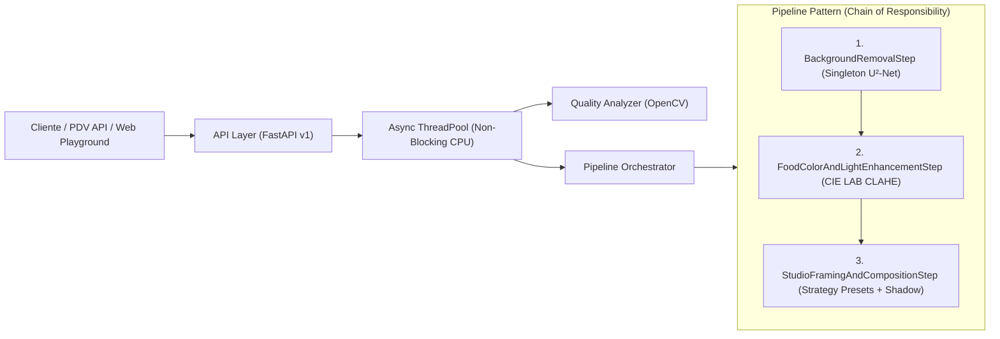

# 🍔 Jet Food Studio IA — Estúdio Fotográfico Inteligente para Delivery

[](https://www.python.org/)
[](https://fastapi.tiangolo.com/)
[](https://opencv.org/)
[](https://onnxruntime.ai/)
[](https://www.docker.com/)

> **Microsserviço de Visão Computacional e Inteligência Artificial** projetado para auxiliar restaurantes, lanchonetes e estabelecimentos gastronômicos a **padronizarem fotos reais de seus pratos** para plataformas de delivery (como **iFood**), eliminando a necessidade de fotos genéricas da internet ou estúdios caros.

📖 **[Acesse aqui a Documentação Completa de Arquitetura & Engenharia (`docs/ARCHITECTURE.md`)](./docs/ARCHITECTURE.md)**

---

## 🎯 O Problema & A Proposta de Valor

Em aplicativos de delivery, pequenos e médios restaurantes enfrentam um dilema:
1. **Falta de capital ou conhecimento técnico** para contratar fotógrafos profissionais ou montar estúdios de iluminação;
2. Ao usar **fotos genéricas da internet**, o cliente não sabe o que realmente está comprando, gerando frustração e avaliações negativas;
3. Ao tirar **fotos amadoras no balcão da cozinha**, o fundo poluído, a sombra escura e a luz amarelada/azulada fazem o prato parecer menos apetitoso, derrubando as vendas.

### 💡 Como o Jet Food Studio IA resolve isso:
- **1. Orienta o Vendedor (`GET /api/v1/guide`):** Entrega um guia direto e prático de fotografia com celular (iluminação natural lateral, fundo neutro, ângulo correto por tipo de comida: `45°` para hambúrgueres e pratos executivos, `90°` zenital para pizzas).
- **2. Diagnostica a Foto Enviada (`POST /api/v1/analyze`):** Usa **Visão Computacional (OpenCV)** para avaliar a foto do lojista de `0 a 100` em 5 critérios (**Iluminação/Exposição**, **Nitidez/Foco via Variância do Laplaciano**, **Contraste**, **Vivacidade HSV** e **Resolução**), retornando dicas práticas em português.
- **3. Padroniza e Trata o Prato (`POST /api/v1/studio/process` & `/compare`):**
  - **Recorte Inteligente com IA (`U²-Net / rembg` + fallback `OpenCV GrabCut`)** com suavização de bordas (*alpha feathering*);
  - **Realce Gastronômico no espaço de cor `CIE LAB`:** recupera iluminação nas sombras com **CLAHE**, aquece a temperatura das cores e realça texturas (queijo derretido, crosta, gergelim) com **Unsharp Mask**;
  - **Fundo de Estúdio Padronizado + Sombra de Contato Realista:** centraliza o prato nas dimensões oficiais de delivery (`1200x900` padrão iFood, `800x800` quadrado ou `1280x720` vitrine) e projeta sombra suave na base do prato.
- **4. Playground Web Interativo (`GET /`):** Interface visual moderna com **slider Antes vs. Depois**, gerador de foto demo com 1 clique, relatório de diagnóstico e guia do vendedor.

---

## 🏗️ Arquitetura & Padrões de Projeto (Design Patterns)

O projeto foi desenvolvido seguindo **Clean Architecture** e boas práticas de sistemas distribuídos:



| Padrão / Prática | Onde foi aplicado | Benefício de Engenharia |
| :--- | :--- | :--- |
| **Pipeline Pattern (Chain of Responsibility)** | `app/services/pipeline/` | Divide o tratamento da imagem em etapas desacopladas (`PipelineStep`) que operam sobre um `ImageContext` e medem a latência individual por estágio. |
| **Singleton Pattern + Lifespan Warm-up** | `app/services/ai_engine.py` | Carrega a sessão neural `U²-Net` uma única vez na subida do servidor (`lifespan`), eliminando *cold-start* a cada requisição e oferecendo fallback automático em OpenCV GrabCut. |
| **Strategy Pattern** | `app/services/studio_generator.py` | Permite alternar dinamicamente entre estratégias de cenário (`clean_studio`, `warm_bistro`, `dark_slate`, `rustic_wood`, `transparent`) e enquadramento (`ifood_standard`, `square_catalog`, `hd_showcase`). |
| **Application Factory & DTOs** | `app/main.py` & `app/schemas/` | Validação estrita de contratos de entrada/saída com **Pydantic v2** e configurações centralizadas via `pydantic-settings`. |
| **Non-Blocking CPU & In-Memory** | `app/api/v1/endpoints/` | Processamento pesado isolado em `run_in_threadpool` e manipulação de arquivos 100% em RAM (`io.BytesIO`), garantindo arquitetura *stateless* pronta para Docker/Cloud. |

---

## 📂 Estrutura de Diretórios

```text
jet-food-studio-ia/
├── app/
│   ├── main.py                      # Application Factory, Lifespan Warm-up, CORS e Middlewares
│   ├── core/
│   │   ├── config.py                # Configurações tipadas com Pydantic BaseSettings (.env)
│   │   ├── exceptions.py            # Exceções de domínio e Global Exception Handlers
│   │   └── logging.py               # Logging estruturado
│   ├── schemas/                     # Contratos de Dados (DTOs Pydantic v2)
│   │   ├── analysis.py              # Modelos do diagnóstico de qualidade (score, métricas)
│   │   ├── guide.py                 # Modelos do guia de fotografia para restaurantes
│   │   └── studio.py                # Enums de presets e opções do pipeline de estúdio
│   ├── api/
│   │   └── v1/
│   │       ├── dependencies.py      # Validação MIME, tamanho máximo e correção EXIF
│   │       ├── router.py            # Agregador de rotas /api/v1
│   │       └── endpoints/
│   │           ├── health.py        # GET /api/v1/health
│   │           ├── guide.py         # GET /api/v1/guide
│   │           ├── analyze.py       # POST /api/v1/analyze
│   │           └── studio.py        # POST /api/v1/studio/process e /api/v1/studio/compare
│   ├── services/
│   │   ├── ai_engine.py             # Singleton da sessão neural U²-Net (rembg) + Fallback GrabCut
│   │   ├── quality_analyzer.py      # Diagnóstico técnico por Visão Computacional (OpenCV)
│   │   ├── studio_generator.py      # Geração procedural de fundos de estúdio e sombra de contato
│   │   └── pipeline/
│   │       ├── base.py              # Abstrações ImageContext e PipelineStep
│   │       ├── steps.py             # Etapas de Recorte, Realce CIE LAB e Enquadramento Delivery
│   │       └── orchestrator.py      # Orquestrador do pipeline e codificador de saída
│   └── static/
│       └── index.html               # Playground Web Interativo (Antes vs. Depois + Guia)
├── docs/
│   └── ARCHITECTURE.md              # Documentação aprofundada de arquitetura e algoritmos
├── tests/
│   └── test_api.py                  # Suíte de testes automatizados de integração (Pytest)
├── .env.example
├── .gitignore
├── Dockerfile
├── pytest.ini
├── requirements.txt
└── README.md
```

---

## 📡 Referência de Endpoints

### 1. Playground Visual Interativo ("Antes e Depois")
- **URL:** `GET /`
- Abre no navegador a interface completa para testar upload de fotos reais (ou gerar uma foto demo instantânea), comparar o **Antes vs. Depois** com slider arrastável, visualizar as notas de diagnóstico e consultar o Guia do Vendedor.

### 2. Healthcheck & Status do Motor IA
- **Rota:** `GET /api/v1/health`
- **Resposta (`200 OK`):**
```json
{
  "status": "healthy",
  "service": "Jet Food Studio IA",
  "version": "1.0.0",
  "ai_engine": {
    "loaded": true,
    "engine_type": "rembg-onnx (u2netp)",
    "configured_model": "u2netp",
    "warm_up_time_ms": 312.4
  }
}
```

### 3. Guia de Fotografia para Restaurantes
- **Rota:** `GET /api/v1/guide`
- Retorna as **4 Regras de Ouro**, requisitos mínimos de resolução, recomendações de ângulo/iluminação por categoria (`Hambúrgueres`, `Pizzas`, `Pratos Executivos`, `Açaí & Sobremesas`) e checklist pré-upload.

### 4. Diagnóstico de Qualidade da Foto (Visão Computacional)
- **Rota:** `POST /api/v1/analyze` (`multipart/form-data` com campo `file`)
- **Exemplo via cURL:**
```bash
curl -X POST "http://localhost:8000/api/v1/analyze" \
  -F "file=@meu_hamburguer.jpg"
```
- **Resposta (`200 OK`):**
```json
{
  "overall_score": 74,
  "status": "GOOD",
  "ready_for_catalog": true,
  "summary": "Boa foto base! O pipeline de IA irá recortar o fundo e realçar a iluminação e textura do prato.",
  "dimensions": {
    "width": 960,
    "height": 720,
    "aspect_ratio": "4:3",
    "megapixels": 0.69
  },
  "metrics": [
    {
      "name": "Iluminação e Exposição",
      "value": 88.4,
      "score": 73,
      "status": "Levemente Escura",
      "feedback": "Foto um pouco subexposta. O tratamento automático irá clarear as sombras do prato."
    }
  ],
  "recommendations": [
    "Posicione o prato mais próximo a uma janela ou fonte de luz suave lateral (evite ambientes escuros)."
  ],
  "suggested_studio_params": {
    "remove_background": true,
    "background_preset": "clean_studio",
    "enhancement_intensity": "balanced",
    "add_contact_shadow": true,
    "framing_preset": "ifood_standard"
  }
}
```

### 5. Processamento e Padronização da Foto (Retorno Binário para Catálogo / S3)
- **Rota:** `POST /api/v1/studio/process` (`multipart/form-data`)
- **Parâmetros (`FormData`):**
  - `file`: Arquivo da imagem (`JPEG`, `PNG`, `WEBP`)
  - `remove_background`: `true` | `false` (default: `true`)
  - `background_preset`: `clean_studio` | `warm_bistro` | `dark_slate` | `rustic_wood` | `transparent`
  - `enhancement_intensity`: `subtle` | `balanced` | `vibrant`
  - `add_contact_shadow`: `true` | `false` (default: `true`)
  - `framing_preset`: `ifood_standard` (`1200x900`) | `square_catalog` (`800x800`) | `hd_showcase` (`1280x720`) | `original`
  - `output_format`: `WEBP` | `JPEG` | `PNG`
- **Exemplo via cURL:**
```bash
curl -X POST "http://localhost:8000/api/v1/studio/process" \
  -F "file=@meu_prato.jpg" \
  -F "background_preset=clean_studio" \
  -F "framing_preset=ifood_standard" \
  -F "enhancement_intensity=balanced" \
  -F "output_format=WEBP" \
  --output prato_padronizado_ifood.webp
```

### 6. Comparativo Completo Antes vs. Depois (JSON + Base64)
- **Rota:** `POST /api/v1/studio/compare`
- Retorna o diagnóstico da foto original (`before_analysis`), o diagnóstico pós-tratamento (`after_analysis`), telemetria de cada etapa do pipeline e a imagem final em Data URL Base64 (`processed_image_data_url`).

---

## 🚀 Como Executar o Projeto

### Pré-requisitos
- **Python 3.10+**

### Passo a Passo
```bash
# 1. Acesse o diretório do projeto
cd c:\workspace\jet-food-studio-ia

# 2. Ative o ambiente virtual
.\.venv\Scripts\Activate.ps1

# 3. (Caso ainda não tenha instalado) Instale as dependências
pip install -r requirements.txt

# 4. Inicie o servidor FastAPI
uvicorn app.main:app --reload --port 8000
```

Acesse no seu navegador:
- 🖥️ **Estúdio Interativo (Antes & Depois):** `http://localhost:8000/`
- 📄 **Documentação Swagger UI:** `http://localhost:8000/docs`

---

## 👨‍💻 Autor

**Vinícius Williams Crispim de Oliveira**  
- Graduando em Ciência da Computação (Estácio)  
- Bacharel em Direito (IESP)  
- [LinkedIn](https://www.linkedin.com/in/vinicius-crispim) · [GitHub](https://github.com/ViniciusCrispim)
