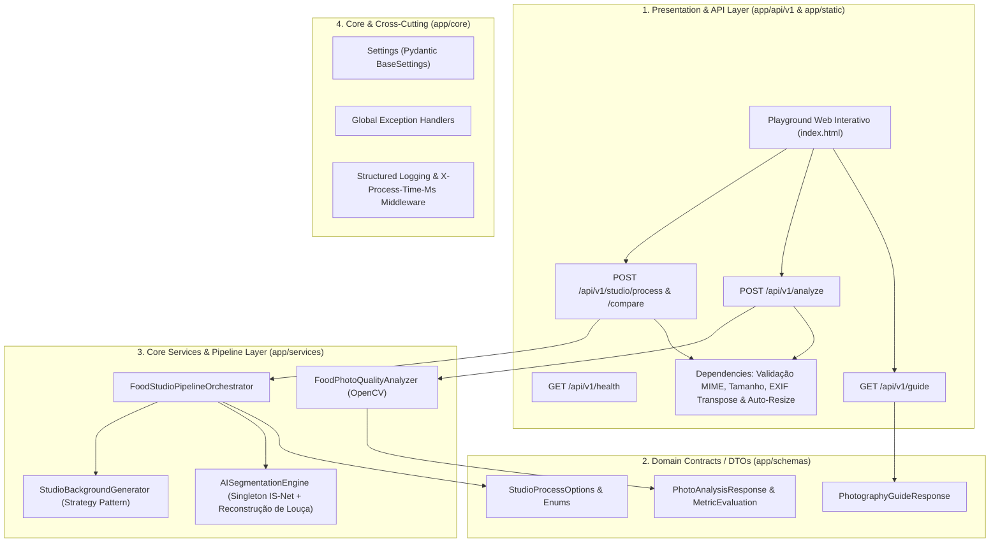

# 🏛️ Documentação de Arquitetura & Engenharia — Jet Food Studio IA

Este documento detalha as decisões arquiteturais, os **Design Patterns (Padrões de Projeto)**, os algoritmos de **Visão Computacional e Inteligência Artificial** e as estratégias de **Escalabilidade e Concorrência** aplicadas na construção do microsserviço **Jet Food Studio IA**.

---

## 1. Visão Geral da Arquitetura (Clean & Layered Architecture)

A aplicação foi estruturada sob os princípios de **Clean Architecture** e **Separation of Concerns (SoC)**, dividindo as responsabilidades em quatro camadas bem definidas e desacopladas:

---

## 2. Padrões de Projeto (Design Patterns) Implementados

### 2.1. Pipeline Pattern / Chain of Responsibility (`app/services/pipeline/`)
Para evitar uma função monolítica de difícil manutenção e testabilidade, o tratamento da imagem foi modelado como um **Pipeline de estágios independentes**:

1. **`ImageContext` ([base.py](file:///c:/workspace/jet-food-studio-ia/app/services/pipeline/base.py)):** Objeto de contexto que transporta a imagem original, a imagem em transformação (`current_image`), as opções solicitadas (`StudioProcessOptions`) e um dicionário de telemetria (`step_timings_ms`).
2. **`PipelineStep` ([base.py](file:///c:/workspace/jet-food-studio-ia/app/services/pipeline/base.py)):** Classe base abstrata (`ABC`) que define o contrato obrigatório (`name` e `process(context) -> ImageContext`) para todas as etapas.
3. **Etapas Concretas ([steps.py](file:///c:/workspace/jet-food-studio-ia/app/services/pipeline/steps.py)):**
   - `BackgroundRemovalStep`: Isola o prato e o alimento removendo o fundo via rede neural (`IS-Net`), reconstrói geometricamente a borda da louça (`_recover_plate_geometry`) e aplica suavização morfológica (*alpha feathering*).
   - `FoodColorAndLightEnhancementStep`: Realça a iluminação, a temperatura de cor e a nitidez especificamente para a fotografia de alimentos no espaço perceptual `CIE LAB`.
   - `StudioFramingAndCompositionStep`: Recorta a caixa delimitadora (*bounding box*) do prato, centraliza na proporção de plataformas de delivery escolhida e compõe sobre o fundo de estúdio com sombra de contato.
4. **`FoodStudioPipelineOrchestrator` ([orchestrator.py](file:///c:/workspace/jet-food-studio-ia/app/services/pipeline/orchestrator.py)):** Executa a cadeia sequencialmente, cronometra o tempo exato (em milissegundos) de cada etapa e codifica a saída final em memória (`WEBP`, `JPEG` ou `PNG`).

### 2.2. Singleton Pattern + Lifespan Warm-up (`app/services/ai_engine.py`)
Redes neurais de segmentação profunda como a **IS-Net (`isnet-general-use` via `rembg` / `ONNX Runtime`)** possuem cerca de 179 MB de pesos. Se o modelo fosse instanciado a cada requisição HTTP:
- Haveria elevado consumo de memória RAM e I/O de disco;
- A latência por requisição ultrapassaria 5 a 8 segundos.

**Solução adotada:**
- A classe `AISegmentationEngine` implementa um **Singleton Thread-Safe** (`threading.Lock`).
- Durante o evento `lifespan` de inicialização do FastAPI ([main.py](file:///c:/workspace/jet-food-studio-ia/app/main.py)), o método `ai_engine.warm_up()` pré-carrega a sessão `new_session("isnet-general-use")` uma única vez na memória RAM.
- **Preservação Geométrica da Louça (`_recover_plate_geometry`):** Em fotos reais nas quais o prato possui tonalidade próxima à da mesa, modelos neurais podem recortar apenas a comida. O motor combina a máscara neural com fechamento morfológico (`cv2.MORPH_CLOSE`), casca convexa (`cv2.convexHull`) e ajuste elíptico (`cv2.fitEllipse`) para preservar a borda completa do prato.
- **Fallback Resiliente (Circuit Breaker Local):** Caso o servidor opere em um ambiente restrito sem os pesos ONNX, o motor aciona automaticamente o algoritmo **OpenCV GrabCut + Salience Mask**, garantindo alta disponibilidade.

### 2.3. Strategy Pattern (`app/services/studio_generator.py` & `app/schemas/studio.py`)
Tanto a geração do cenário de fundo quanto o enquadramento funcionam como estratégias intercambiáveis selecionadas por parâmetros tipados:
- **Estratégias de Fundo (`StudioBackgroundPreset`):**
  - `clean_studio`: Gradiente branco/off-white com iluminação radial *softbox* (padrão de catálogos de delivery).
  - `warm_bistro`: Tons creme quentes para padarias, doces, açaí e massas.
  - `dark_slate`: Ardósia escura gourmet para hambúrgueres artesanais, carnes e culinária oriental.
  - `rustic_wood`: Paleta amadeirada quente para pizzas e porções.
  - `transparent`: Mantém o canal Alpha 100% transparente.
- **Estratégias de Enquadramento (`FramingPreset`):**
  - `delivery_standard` (`1200x900` — proporção `4:3` recomendada para plataformas de delivery).
  - `square_catalog` (`800x800` — proporção `1:1`).
  - `hd_showcase` (`1280x720` — proporção `16:9`).
  - `original` (preserva as dimensões nativas).

### 2.4. Application Factory & Dependency Injection (`app/main.py` & `app/api/v1/dependencies.py`)
- `create_application()` encapsula a criação da instância FastAPI, os middlewares de CORS, a telemetria de tempo e o registro de handlers globais de exceção.
- `validate_and_load_image()` atua como validador reutilizável de entrada: verifica o `Content-Type` e a extensão, bloqueia arquivos acima de `MAX_UPLOAD_SIZE_MB` (HTTP `413`), rejeita formatos inválidos (HTTP `415`), aplica `ImageOps.exif_transpose` para corrigir a orientação EXIF de smartphones e redimensiona preventivamente imagens gigantes (`>1600px`) com filtro `LANCZOS` para evitar sobrecarga de memória.

---

## 3. Algoritmos de Visão Computacional & Tratamento Gastronômico

### 3.1. Diagnóstico Técnico da Foto (`FoodPhotoQualityAnalyzer`)
Localizado em [quality_analyzer.py](file:///c:/workspace/jet-food-studio-ia/app/services/quality_analyzer.py), avalia cinco dimensões matemáticas da imagem e gera uma nota ponderada de `0 a 100`:

| Métrica | Algoritmo / Cálculo | O que detecta para o vendedor |
| :--- | :--- | :--- |
| **Iluminação e Exposição** | Média do canal de luminância $\mu_Y \in [0, 255]$ | Fotos escuras de cozinha ($\mu_Y < 105$) ou estouradas por flash ($\mu_Y > 175$). |
| **Nitidez e Foco** | Variância do operador Laplaciano $\text{Var}(\nabla^2 I)$ | Lente suja de gordura, foto tremida ou fora de foco. |
| **Contraste Dinâmico** | Desvio padrão da luminância $\sigma_Y$ | Fotos opacas ("lavadas") ou com sombras excessivamente duras. |
| **Vivacidade de Cores** | Média do canal de Saturação ($S$) no espaço `HSV` | Alimentos com aparência pálida ou fria sob iluminação fluorescente. |
| **Resolução de Catálogo** | Área em pixels ($W \times H$) e proporção | Fotos comprimidas de aplicativos de mensagem ou miniaturas de baixa definição. |

### 3.2. Realce Gastronômico no Espaço de Cor CIE LAB
Diferentemente de filtros comuns que apenas aumentam o brilho e o contraste em `RGB` (o que distorce as cores naturais da comida), o `FoodColorAndLightEnhancementStep` converte a imagem para o espaço perceptual **CIE LAB**:
1. **Canal $L$ (Luminosidade):** Aplica correção Gamma adaptativa (quando a imagem está subexposta) seguida de **CLAHE** (*Contrast Limited Adaptive Histogram Equalization*), revelando detalhes nas sombras do prato sem estourar as áreas claras.
2. **Canais $A$ (Verde–Vermelho) e $B$ (Azul–Amarelo):** Adiciona um deslocamento positivo controlado (*Warmth Shift*), neutralizando o aspecto azulado ou frio de lâmpadas fluorescentes e realçando tons quentes apetitosos (dourado de pães e assados, vermelho de molhos e carnes, amarelo de queijos).
3. **Unsharp Mask:** Realça microtexturas (gergelim, crosta, brilho de molho).

### 3.3. Sombra de Contato Elíptica Gaussiana
Para evitar que o prato recortado pareça "colado ou flutuando" sobre o novo cenário, o `StudioBackgroundGenerator` analisa os limites inferiores da máscara Alpha e projeta uma elipse sombreada com desfoque Gaussiano proporcional à largura da base do prato.

---

## 4. Escalabilidade, Performance e Observabilidade

1. **Non-Blocking Event Loop (`run_in_threadpool`):**
   Embora as rotas FastAPI sejam `async def` para leitura assíncrona de rede (`await file.read()`), o processamento matricial com OpenCV, NumPy e ONNX é *CPU-bound*. Todas as chamadas ao `quality_analyzer` e ao `pipeline_orchestrator` são executadas via `run_in_threadpool`, mantendo o loop de eventos livre para atender múltiplas requisições simultâneas.
2. **100% Stateless & In-Memory (`io.BytesIO`):**
   Nenhuma imagem enviada pelo usuário é gravada no disco do servidor. Todo o fluxo entra e sai por buffers em memória RAM, permitindo escalar horizontalmente múltiplos containers em **Docker, Kubernetes, Google Cloud Run ou AWS ECS**.
3. **Headers de Telemetria em Tempo Real:**
   Toda resposta do estúdio inclui cabeçalhos HTTP de observabilidade:
   - `X-Process-Time-Ms`: Tempo total da requisição HTTP.
   - `X-Studio-Total-Time-Ms`: Tempo total do endpoint de estúdio.
   - `X-Studio-Step-Timings-Ms`: Tempo individual de cada etapa do pipeline (ex.: `background_removal:410.2,food_color_light_enhancement:185.4,studio_framing_and_composition:112.0`).
   - `X-Studio-Segmentation-Engine`: Motor utilizado (`rembg-onnx (isnet-general-use)` ou `opencv-grabcut-salience`).
   - `X-Studio-Final-Dimensions`: Resolução final entregue (ex.: `1200x900`).
